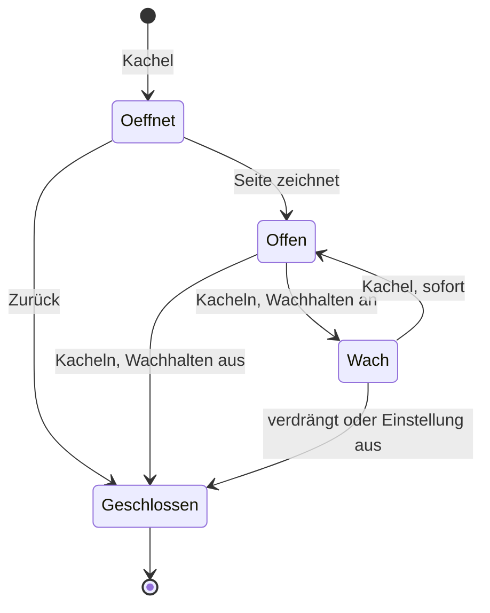

# Kacheln öffnen schneller
Problem: Nach dem Klick passiert gefühlt nichts, die Seite kommt nach etwa 3 s.
Ziel: Das Öffnen eines Dienstes fühlt sich ab dem Klick schnell und sicher an; wer will, kehrt ohne Laden zurück.
Fertig, wenn:
- [x] Der Klick zeigt sofort, dass der Dienst öffnet (of-01)
- [x] Kein weißes Aufblitzen zwischen Kachel und Seite (of-01)
- [x] Die Seite zeichnet nicht später als vorher (A/B-Probe, of-01)
- [x] Mit „Wachhalten: Aus“ bleibt RAM auf den Kacheln im Budget (of-02)
- [x] Mit Wachhalten ist der Rückweg zu einem wachen Dienst unter 0,1 s (of-02)

## Entschieden
- Gemessen: Gleich bedingt ist floawty so schnell wie Chrome; die Wartezeit ist das Laden der Seite.
- Wiederverwendete Webview gestrichen (spart etwa 0,05 s).
- Die Kachel zeigt das Öffnen, die anderen treten zurück; weitere Klicks zählen nicht; Zurück bricht ab.
- Die Seite übernimmt, sobald sie zu zeichnen beginnt; bis dahin floawtys Grundfarbe statt weiß.
- Wachhalten als Einstellung: Aus (Vorgabe), letzter Dienst, bis 3 Dienste; wach bis verdrängt oder floawty endet.
- Rückkehr zeigt dieselbe Seite, Video pausiert; wache Dienste sind still; nichts wird vorgeladen.

## Plan
1. of-01 „Öffnen sichtbar“ – fertig ([[of-01-opening-shown]])
2. Design-Prüfung of-02 durch `advisor` – fertig, Ergebnisse in [[of-02-keep-awake]]
3. of-02 „Wachhalten“ – fertig ([[of-02-keep-awake]])
