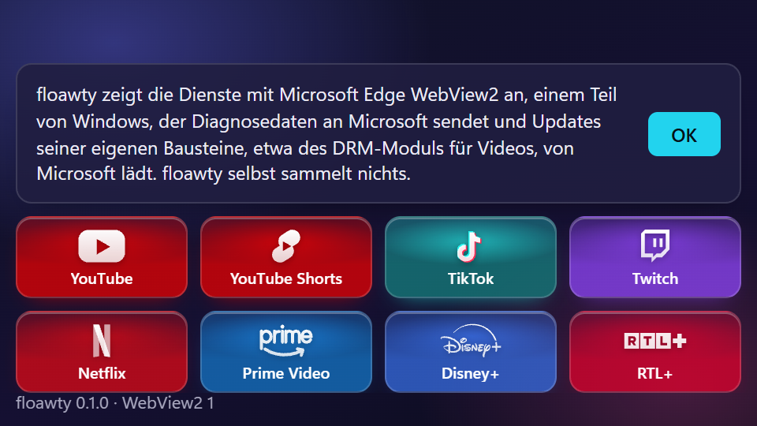
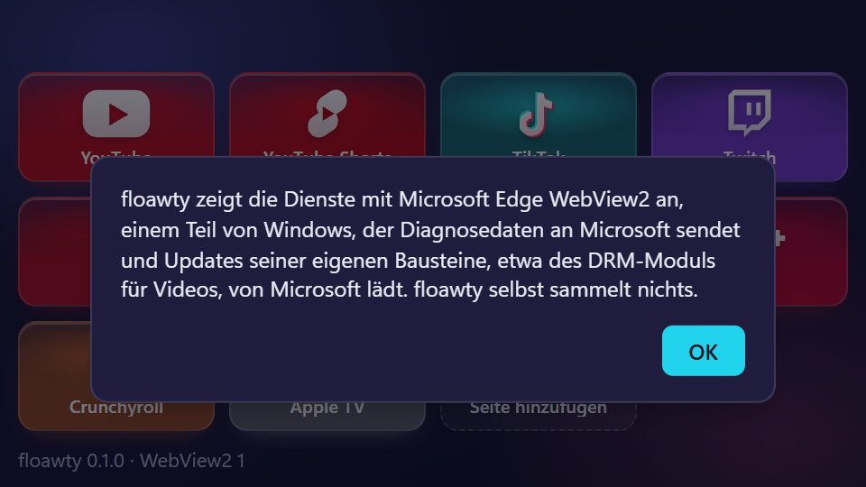
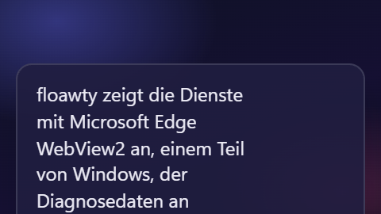
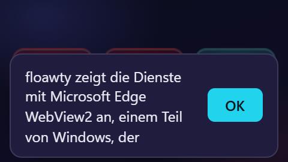

# Startseite: Animationen und Hinweis
Problem: Die Animationen kosten nach dem Hover RAM, abschalten geht nur windowsweit. Und beim ersten Start schiebt der WebView2-Hinweis die Kacheln aus dem Bild.
Ziel: Wer will, schaltet die Animationen in floawty ab, und der Hinweis liegt über den Kacheln.
Fertig, wenn:
- [ ] „Aus“ beruhigt floawty sofort und übersteht einen Neustart
- [ ] Mit „aus“ gestartet: Hover-RAM klar unter 267 MB, in der App gemessen
- [ ] Der Hinweis verschiebt keine Kachel
- [ ] Hinweis lesbar und OK erreichbar, auch bei 240 × 135

Vorher: 
Nachher: 
Vorher: 
Nachher: 

## Entschieden
- Schalter „Animationen“ in Allgemein, direkt unter „Design“
- Er schaltet alle Animationen ab, das Leuchten bleibt
- Standard ist „an“, auch für alte Einstellungen; die Neigung bleibt Standard (beantwortet offene Frage 10)
- Umschalten wirkt sofort; ein Satz darunter sagt: weniger RAM ab dem nächsten Start
- „Animationseffekte aus“ in Windows gewinnt immer
- „Alle Daten löschen“ stellt auf „an“
- Die Wahl kommt später in den Einstellungs-Export (rel-05)
- Hinweis mittig über der abgedunkelten Startseite, Kacheln erst nach OK
- In schmalen oder flachen Fenstern steht OK neben dem Text, nur der Text scrollt
- Fenster bleibt dabei ziehbar, die Leiste bedienbar, der Fokus liegt auf OK
- Beides ist ein Paket gl-05

## Plan (freigegeben am 22.11.2026)
1. Decision, Paket gl-05, Frage 10 schließen; `advisor` prüft Format und IPC vorab (ein neues Feld, fehlt es, gilt „an“)
2. Tests zuerst: Cargo für das Feld, Adapter-Projekt für Hinweis und Ruhe, App-Tests für Umschalten und Neustart
3. Schalter und Hinweis bauen, Texte DE und EN, bestehende Tests anpassen, Tech-Notes und CHANGELOG
4. `npm run check`, unabhängiges Review
5. Nach deinem Ja: neue Tests (1 min)
6. Nach deinem Ja: alle App-Tests (2 min)
7. Nach deinem Ja: Hover mit „aus“ dreimal (6 min)
8. Commit-Vorschlag
